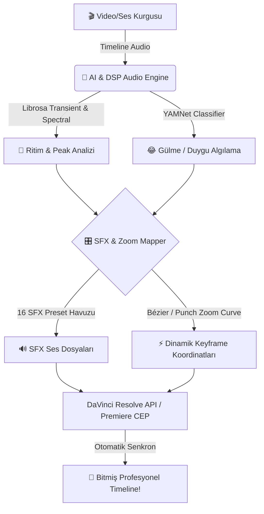

<div align="center">

  # ⚡ BEATDROP STUDIO ⚡
  ### 🎬 Yapay Zeka Destekli Otomatik Ses Tasarımı & Dinamik Zoom Motoru 🚀
  
  <p align="center">
    <strong>Video kurgucuları, YouTuber'lar ve içerik üreticileri için geleceğin post-prodüksiyon asistanı!</strong><br>
    DaVinci Resolve & Adobe Premiere Pro projelerinizde tek tıkla ritim vuruşlarını, komik anları ve geçişleri yakalayın, ses efektlerini ve dinamik punch-in zoom'ları otomatik dizin.
  </p>

  <!-- GitHub Rozetleri (Badges) -->
  <p align="center">
    
    
    
    
    
    
  </p>

  <!-- GitHub Animasyonlu Maskot -->
  

</div>

---

<p align="center">
  
</p>

## 🌟 Neden BeatDrop Studio? 🎯

Manuel olarak tek tek **Whoosh**, **Vine Boom** veya **Impact** arayıp timeline'a sürüklemekten, saniye saniye zoom keyframe'i vermekten yoruldunuz mu? ⏳

**BeatDrop Studio**, videonuzun ses kanalını yapay zeka (YAMNet) ve gelişmiş dijital ses işleme (DSP / Librosa Onset & Transient Detection) algoritmalarıyla tarar:
* 💥 **Vurguları & Düşüşleri (Beat Drops):** Müzik patlamalarını ve bas vuruşlarını algılar.
* 😂 **Duygu & Reaksiyonları:** Gülme, kahkaha, çığlık veya ani sessizlikleri yakalar.
* 🎬 **Geçişleri:** Hızlı kamera hareketleri ve sahne geçişlerini hisseder.
* ⚡ **Doğrudan Kurgu Çizginize Yazar:** DaVinci Resolve ve Premiere Pro timeline'ına ses efektlerini ve dinamik punch-in zoom keyframe'lerini milisaniyelik hassasiyetle yerleştirir!

---

## ✨ Öne Çıkan Özellikler 🚀

<div align="center">

| Özellik | Açıklama | Destek |
| :--- | :--- | :---: |
| 🤖 **Yapay Zeka Ses Tespiti** | Kahkaha, alkış, patlama ve geçişleri sinir ağıyla otomatik sınıflandırır | ✅ |
| 🎛️ **Dinamik Punch-In Zoom** | Vurgularda videoyu %105-%125 oranında dinamik yaklaştırıp eski haline döndürür | ✅ |
| 🔊 **16 Stüdyo SFX Paketi** | Vine Boom, Whoosh, Sub Bass, Punch, Rizz ve daha fazlası hazır gelir | ✅ |
| 🎨 **Obsidian Stüdyo Arayüzü** | CustomTkinter tabanlı, koyu mor neon stüdyo asistanı paneli | ✅ |
| 🧩 **Premiere Pro CEP Dockable** | Adobe Premiere Pro'nun içine gömülü (panel olarak yapışan) arayüz | ✅ |
| ⚡ **Otomatik Timeline Algılama** | Dosya seçmeden, aktif kurgu klibini tek tıkla doğrudan yakalama | ✅ |

</div>

---

<p align="center">
  
</p>

## 🎛️ 4 Akıllı Kurgu Modu (Presets) 🎭

Tek bir tıklamayla projenizin havasını belirleyin:

* 🔥 **Hype / Aksiyon:** Yüksek tempolu montajlar, sert bas darbeleri, agresif punch-in zoomlar ve hızlı swoosh efektleri.
* 😂 **Mizah & Meme:** Komik YouTube & TikTok videoları için Vine Boom, Bruh, Cartoon Boing ve Rizz sesleri.
* 🎬 **Sinematik:** Derin sub-bass vuruşları, pürüzsüz geçiş whoosh'ları ve zarif kamera yaklaştırmaları.
* 🎙️ **Vlog / Podcast:** Konuşmayı bölmeyen yumuşak pop efektleri, bildirim çanları ve hafif geçişler.

---

## 🔊 Dahili 16 Efektlik Ses Kütüphanesi 🎧

BeatDrop Studio ile birlikte 16 popüler efekt tam kalitede hazır gelir:

```
📦 assets/sfx/
 ├── 💥 vine_boom.wav       ├── 💨 whoosh.wav          ├── 🥊 punch.wav
 ├── 🗿 bruh.wav            ├── 🌪️ swoosh.wav          ├── 💣 boom.wav
 ├── 🎷 rizz.wav            ├── 📉 whoosh_down.wav     ├── 🔨 impact.wav
 ├── 🌀 cartoon_boing.wav   ├── ⏩ swipe.wav           ├── 🔊 sub_bass.wav
 ├── 🎈 pop.wav             ├── 🔔 ding.wav            ├── ✨ sparkle.wav
 └── 🎐 chime.wav
```

> 💡 **Not:** Efektleri panel üzerindeki **Mini Sound Deck** düğmelerine tıklayarak doğrudan dinleyebilirsiniz!

---

<p align="center">
  
</p>

## 🛠️ Kurulum & Hızlı Başlangıç ⚡

### 1️⃣ Tek Tıkla Kurulum (Önerilen) 📦
1. [Releases](https://github.com/) sayfasından en son `BeatDropStudio_Setup.exe` dosyasını indirin.
2. Kurulum sihirbazını çalıştırın; gerekli motorları, ses paketlerini ve DaVinci/Premiere köprülerini otomatik kuracaktır.

---

### 2️⃣ Manuel Geliştirici Kurulumu 💻
```bash
# 1. Repoyu klonlayın
git clone https://github.com/kullanici-adiniz/beatdrop-studio.git
cd beatdrop-studio

# 2. Sanal ortamı oluşturun ve aktif edin
python -m venv venv
venv\Scripts\activate     # Windows

# 3. Gerekli kütüphaneleri yükleyin
pip install -r backend/requirements.txt
pip install customtkinter requests

# 4. Backend motorunu başlatın
cd backend
python -m uvicorn main:app --host 127.0.0.1 --port 8765
```

---

## 🎬 Nasıl Kullanılır? 🕹️

<details>
<summary><b>🎥 DaVinci Resolve ile Kullanım (Tıklayın)</b></summary>

1. DaVinci Resolve'u açın ve kurgulamak istediğiniz projeye girin.
2. Masaüstündeki **`BeatDrop Studio (DaVinci).bat`** kısayoluna çift tıklayın.
3. Koyu mor stüdyo panelimiz açılacaktır:
   * **Stil:** İstediğiniz kurgu modunu seçin (Örn: *🔥 Hype* veya *😂 Mizah*).
   * **Kaynak:** *"Aktif Timeline'daki Klibi Otomatik Al"* seçeneğini işaretli bırakın.
   * **Zoom:** Dilediğiniz Punch-in yüzdesini ayarlayın (Örn: *%108*).
4. **`✨ TIMELINE'A UYGULA`** butonuna basın!
5. DaVinci timeline'ınızda ses efektlerinin ve zoom keyframe'lerinin otomatik oluştuğunu izleyin! 🚀
</details>

<details>
<summary><b>🎞️ Adobe Premiere Pro ile Kullanım (Tıklayın)</b></summary>

1. Adobe Premiere Pro'yu açın.
2. Üst menüden: **Window ➔ Extensions ➔ BeatDrop Studio** yolunu izleyin.
3. Panel doğrudan Premiere Pro'nun içine sekme olarak yerleşecektir!
4. Timeline'ınızdaki sesi seçip **Analiz Et ve Uygula** demeniz yeterlidir.
</details>

---

<p align="center">
  
</p>

## 🏗️ Mimari & Teknoloji Yığını 🧠



* **Frontend:** CustomTkinter (Python Modern GUI) & Adobe CEP (HTML5 / Glassmorphism)
* **Backend Engine:** FastAPI, Uvicorn, Python 3.12+
* **Audio Analysis:** Librosa, NumPy, SciPy (DSP Algoritmaları), Google YAMNet AI
* **NLE Entegrasyonları:** DaVinci Resolve Python/Lua Bridge, Adobe ExtendScript API

---

## 🤝 Katkıda Bulunma (Contributing) 💡

Katkılarınızı heyecanla bekliyoruz!
1. Bu depoyu Fork'layın (`Fork`).
2. Yeni özelliğiniz için bir dal açın (`git checkout -b feature/HarikaOzellik`).
3. Değişikliklerinizi commit'leyin (`git commit -m 'feat: Yeni ses efekti eklendi'`).
4. Dalınıza push'layın (`git push origin feature/HarikaOzellik`).
5. Bir **Pull Request (PR)** açın!

---

## 💖 Destek Olun ⭐

Eğer **BeatDrop Studio** kurgu sürecinizi hızlandırdıysa ve işinize yaradıysa, lütfen projeye bir **Yıldız (Star) ⭐** vermeyi unutmayın!

<div align="center">

  <a href="https://github.com/">
    
  </a>

  <br>
  <strong>Geliştirici:</strong> BeatDrop Studio Ekibi 🎧<br>
  <i>"Kurgunuzun ritmini yapay zeka belirlesin!"</i>

</div>

---

<p align="center">
  <sub>MIT License © 2026 BeatDrop Studio. Tüm hakları saklıdır.</sub>
</p>
